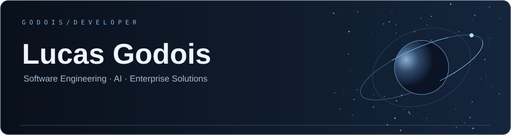

  

 &nbsp;  &nbsp; 

## 01 / About me

I'm a technology professional based in Brazil, working at the intersection of **software engineering, artificial intelligence and enterprise solutions**.

At Latin-Re, I build internal applications, automate business processes, develop analytics solutions and work on integrations between reinsurance platforms and the Microsoft ecosystem. I collaborate with international development teams on technical requirements, troubleshooting and validation.

Outside work, I explore scientific computing, machine learning and technology for social impact, including **ASTRAL** (astronomical AI) and **FarmaFlux** (award-winning digital health prototype).

## 02 / Engineering in practice

| Domain | Focus |
| :--- | :--- |
| **Enterprise software** | Internal systems, claims and compliance workflows |
| **Systems integration** | Reinsurance platforms, API requirements and Microsoft Graph |
| **Intelligent automation** | Microsoft 365, workflow orchestration and AI-assisted processes |
| **Data & analytics** | Business intelligence, DAX and operational reporting |
| **International collaboration** | Technical requirements, issue investigation, testing and validation |

*Enterprise implementations are proprietary and are not published here.*

## 03 / Technology stack

**Languages & markup**

 

**Frontend & backend**

**Machine learning & scientific computing**

 

**Enterprise, data & automation**

   

**Development tools**

## 04 / GitHub activity

  
  

Public GitHub activity reflects only part of my work. Enterprise projects are maintained in private environments. The native contribution calendar below this README provides the full GitHub profile history.

## 05 / Recognition

| Recognition | Year |
| :--- | :---: |
| **Hackathon Projeção — winning team, FarmaFlux** | 2026 |
| **Melhores do Seguro — Revista Apólice, Latin-Re's AI and operational efficiency case (company recognition)** | 2026 |

## 06 / Explore my work

My featured repositories are pinned directly below this README. [Browse all repositories →](https://github.com/godoiss?tab=repositories)

  

